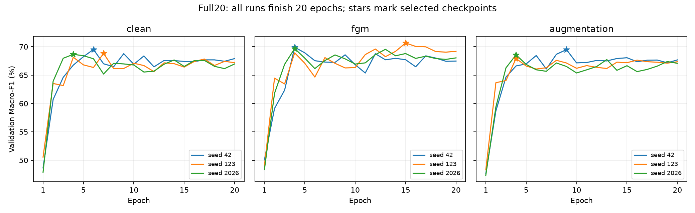

# Full20 training results

All nine runs completed 20 epochs, with early stopping disabled. The worker downloaded each result and independently verified validation predictions, metrics, checkpoint selection, stopping configuration, step counts and frozen noise-bank SHA256. Campaign verification completed 2026-10-31 16:38 Asia/Ho_Chi_Minh.

## Best validation Macro-F1

| Condition | Seed 42 | Seed 123 | Seed 2026 | Mean ± sample SD |
|---|---:|---:|---:|---:|
| clean | 69.53% | 68.83% | 68.66% | 69.00 ± 0.46 pp |
| fgm | 69.91% | 70.66% | 69.69% | 70.08 ± 0.51 pp |
| augmentation | 69.49% | 67.93% | 68.57% | 68.67 ± 0.78 pp |

FGM exceeds clean in validation for all three matched seeds; its mean advantage is 1.08 percentage points. Augmentation mean differs from clean by -0.34 points.

These scores select checkpoints on validation. They do not establish test generalization, statistical significance, or robustness to noise. Sample SD describes variation across three training seeds, not a confidence interval. Test/noise evaluation has not yet run for these checkpoints.

## Per-run details

| Run | Best epoch | Epoch 20 Macro-F1 | Training minutes |
|---|---:|---:|---:|
| clean-s42 | 6 | 67.91% | 56.9 |
| fgm-s42 | 4 | 67.48% | 116.7 |
| augmentation-s42 | 9 | 67.68% | 68.3 |
| clean-s123 | 7 | 67.20% | 55.1 |
| fgm-s123 | 15 | 69.19% | 107.7 |
| augmentation-s123 | 4 | 67.35% | 68.8 |
| clean-s2026 | 4 | 66.97% | 55.1 |
| fgm-s2026 | 4 | 68.04% | 112.8 |
| augmentation-s2026 | 4 | 67.08% | 70.7 |

Total training time summed over nine runs: 11.87 hours. This is not wall-clock elapsed time or an account quota reading.

The monitoring worker stopped normally after all nine runs passed verification. Checkpoints remain on their private Kaggle notebook outputs; downloaded local artifacts contain validation evidence and summaries.

Next: freeze the nine selected checkpoints, verify checkpoint-to-validation agreement, evaluate identical original/noisy diagnostic views, and report matched seed comparisons. The original test was previously viewed and must not be described as a blind confirmatory evaluation.

