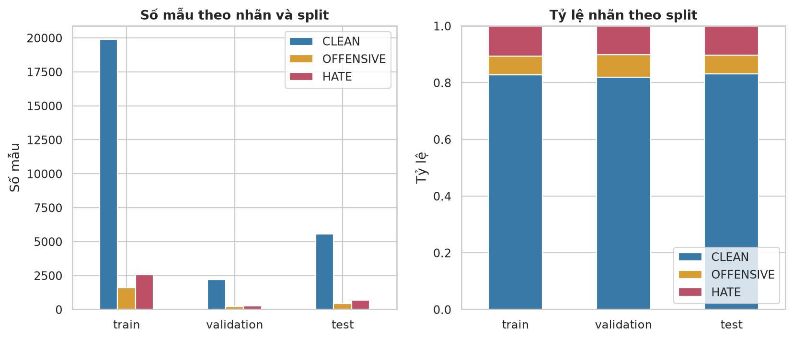
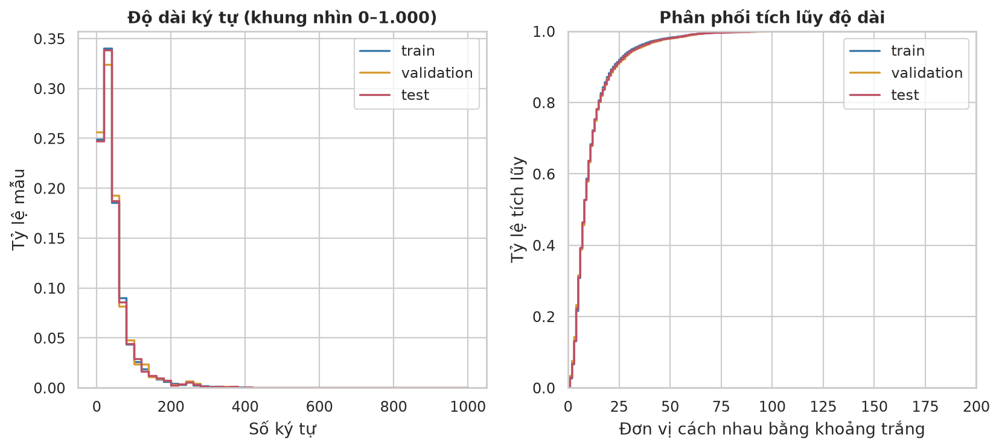
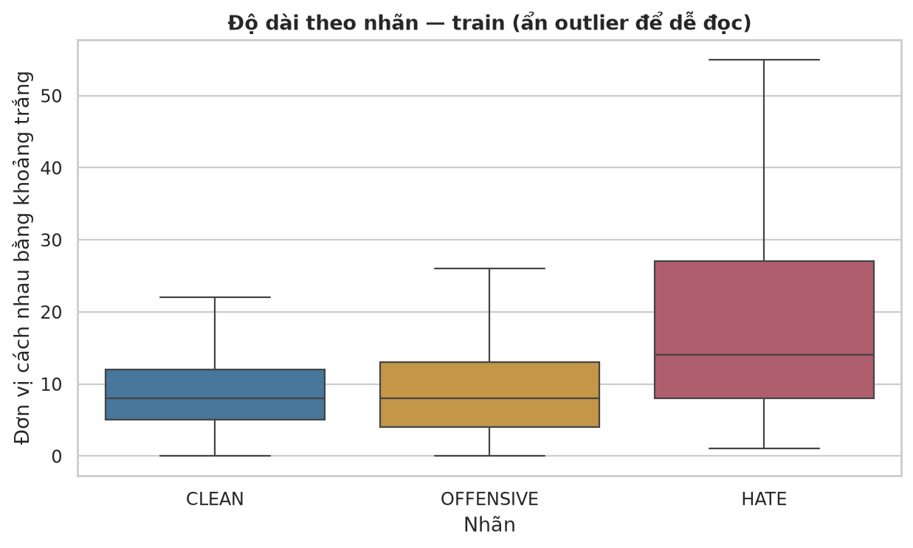
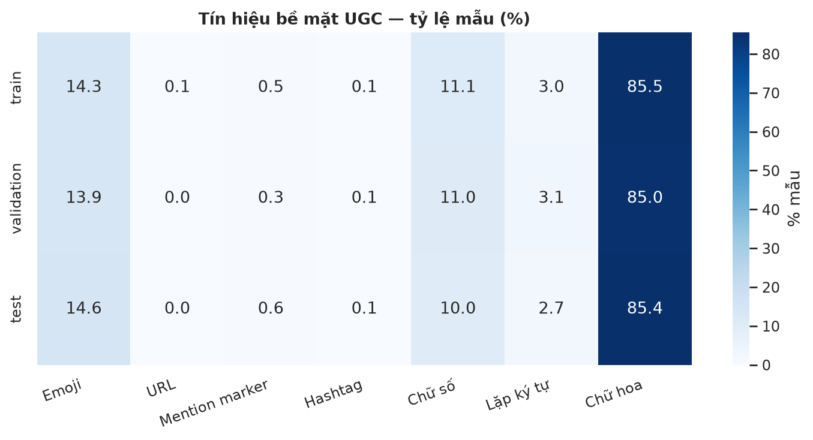
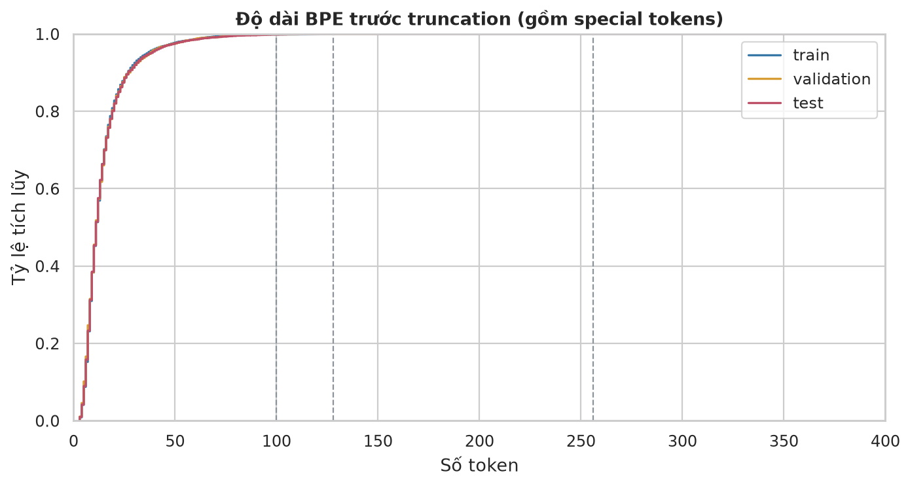

# EDA ViHSD — baseline PhoBERT phục vụ robustness

## Dữ liệu và phạm vi

Nguồn: archive trong GitHub chính thức `sonlam1102/vihsd`, phiên bản/checksum trong manifest.
Giữ nguyên split chính thức. Test gốc nghĩa là chưa thêm nhiễu nhân tạo; vẫn có lỗi gõ và UGC tự nhiên.
Các thống kê test chỉ mô tả dữ liệu, không dùng để lựa chọn siêu tham số hoặc sửa preprocessing.

## Phát hiện chính

- Tổng **33,400** mẫu gốc; train **24,048**, validation **2,672**, test **6,680**.
- CLEAN chiếm **82.69%** train. Accuracy cao có thể do dự đoán lớp đa số; chọn **Macro-F1** làm chỉ số chính.
- Baseline luôn đoán CLEAN trên validation: accuracy **0.8196**, Macro-F1 **0.3003**.
- Có **2** dòng rỗng sau chuẩn hóa kỹ thuật. Hai dòng rỗng thuộc train được ghi vào exclusion ledger; raw và split đánh giá giữ nguyên.
- Sau NFC/khoảng trắng: **1,177 nhóm trùng giữa các split**, **242 nhóm cùng văn bản khác nhãn** trên toàn bộ dữ liệu. Đây là giới hạn quan trọng của đánh giá split chính thức; không tự deduplicate.
- Emoji/chữ hoa/ký tự lặp là tín hiệu bề mặt, không phải nhãn độc hại. Giữ nguyên để baseline phản ánh UGC.

## Quyết định pipeline

1. Giữ nguyên train/validation/test chính thức; chỉ loại hai mẫu train không có nội dung theo ledger có ID cụ thể.
2. Unicode NFC và khoảng trắng; giữ dấu, case, emoji, URL, hashtag, teencode và ký tự kéo dài.
3. Truyền UTF-8 qua cầu nối Java để bảo toàn emoji/non-BMP, rồi RDRSegmenter và PhoBERT BPE; không xóa stopword, không sửa chính tả bằng từ điển.
4. `max_length=256` gồm special tokens. Thống kê truncation dưới đây dùng để ghi nhận mất thông tin; cấu hình được định trước và không điều chỉnh theo test.
5. Cross-entropy thường, không resampling/class weight ở lần chạy đầu. Báo cáo precision/recall/F1 theo từng lớp.

## Cách đọc số liệu

Độ dài theo khoảng trắng là số đơn vị phân cách, không phải số từ tiếng Việt sau segmentation.
Mention marker chỉ nhận `@...` hoặc placeholder, không suy ra được toàn bộ tên người được mention.
Emoji và lặp ký tự được nhận dạng heuristic nên không phải annotation chuẩn.
Không suy luận quan hệ nhân quả giữa segmentation và sai nhãn từ EDA.

## Tokenization thực tế

- **train**: median 11, p95 37, p99 64 token; cắt ở 256: 0.04%; `<unk>` trên token nội dung: 2.0900%.
- **validation**: median 11, p95 38, p99 64 token; cắt ở 256: 0.00%; `<unk>` trên token nội dung: 2.1714%.
- **test**: median 11, p95 38, p99 67 token; cắt ở 256: 0.01%; `<unk>` trên token nội dung: 2.1141%.

Không đồng nhất `<unk>` với phân mảnh: hai chỉ số được đo riêng trong bảng tokenization.

