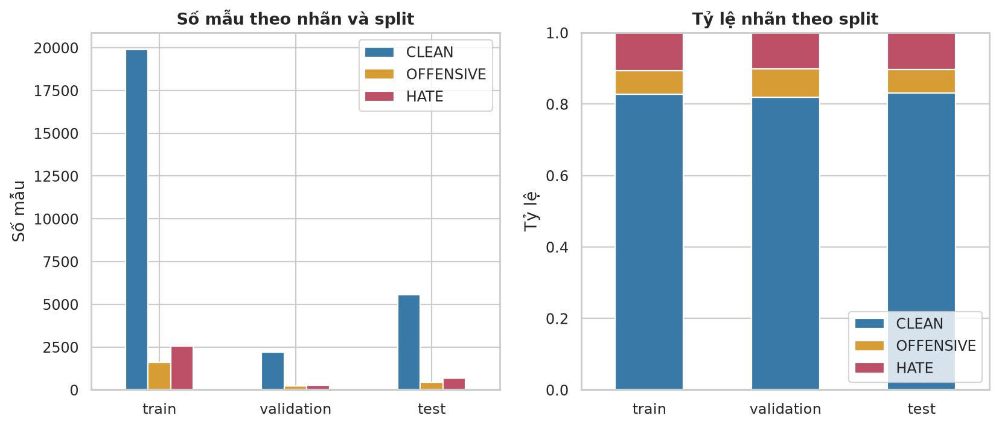
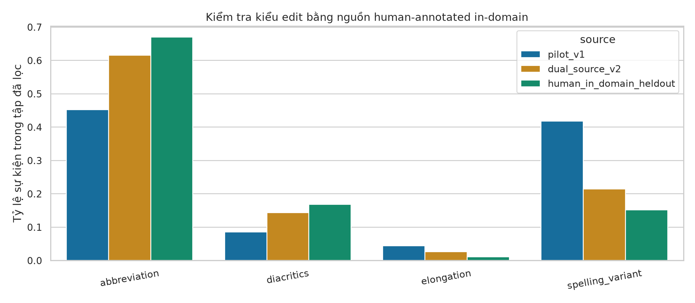
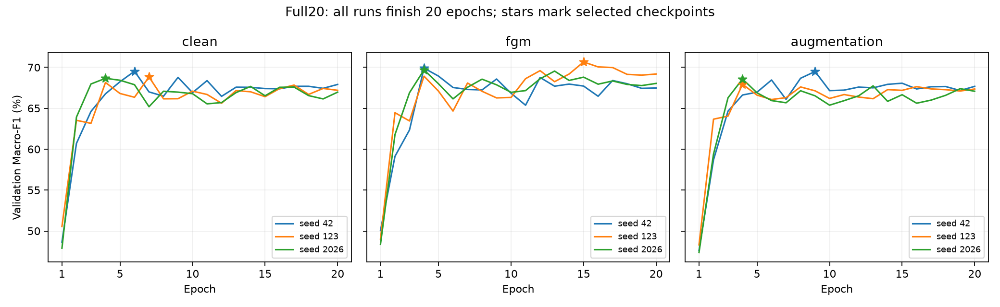
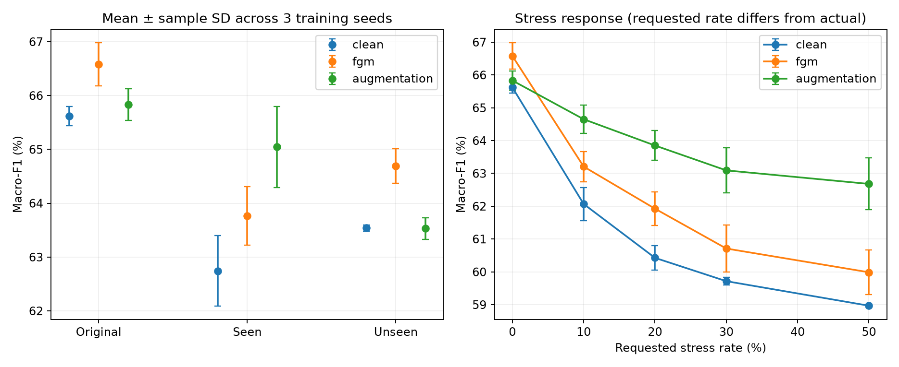
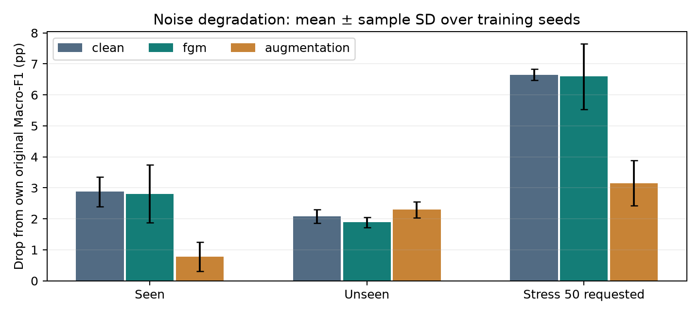
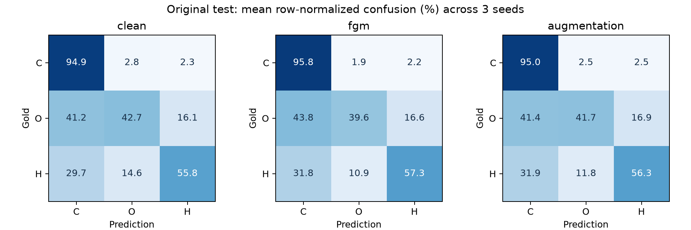

# Đánh giá và tăng cường độ bền vững của PhoBERT trên ViHSD

Báo cáo nghiên cứu từ dữ liệu đến huấn luyện và đánh giá. Cập nhật: 31/10/2026.

## Tóm tắt

Báo cáo tổng hợp quá trình xây dựng pipeline, nghiên cứu nhiễu và đánh giá PhoBERT trên ViHSD đến ngày 31/10/2026. Kết quả chính lấy từ đợt thực nghiệm Full20: 3 phương pháp × 3 training seed, mỗi run train đủ 20 epoch, sau đó đánh giá checkpoint được chọn bằng validation trên 11 bộ dữ liệu giống nhau. Toàn bộ 99 lượt model/profile đã được tải và xác minh độc lập.

| Phương pháp | Test gốc | Nhiễu seen | Nhiễu unseen |
|---|---|---|---|
| PhoBERT clean | 65.62 ± 0.18 | 62.74 ± 0.66 | 63.54 ± 0.06 |
| PhoBERT + FGM | 66.58 ± 0.40 | 63.77 ± 0.54 | 64.69 ± 0.32 |
| PhoBERT + augmentation | 65.83 ± 0.30 | 65.04 ± 0.75 | 63.53 ± 0.20 |

Chỉ số trong bảng là Macro-F1 (%), mean ± độ lệch chuẩn mẫu qua 3 training seed. Với empirical seen/unseen, lấy trung bình 3 noise seed bên trong từng training run trước khi tổng hợp. Đây không phải confidence interval.

- FGM ε=0,1 cao hơn clean trên cả ba training seed ở test gốc, seen và unseen. Mean delta lần lượt là +0,96; +1,02; +1,15 điểm phần trăm Macro-F1.
- Augmentation dùng biến thể quan sát được cho lợi ích rõ trên seen (+2,30 điểm) và stress; không cải thiện unseen toàn test (khoảng -0,01 điểm).
- Phần lớn lợi thế tuyệt đối của FGM đã hiện diện trên test gốc. Khi trừ điểm gốc của từng model, lợi ích bổ sung về mức suy giảm do nhiễu nhỏ hơn nhiều; không quy toàn bộ +1,15 điểm unseen thành hiệu quả chống nhiễu riêng biệt.
- Các câu tổng hợp kế thừa nhãn độc hại; chưa được người gán nhãn lại. Nguồn normalization có annotation của người không tự chứng nhận tính tự nhiên hoặc giữ nhãn độc hại cho mọi câu được sinh.

Đã hoàn tất phần PhoBERT clean, FGM, augmentation, EDA, benchmark v2, 9 run Full20 và 99 lượt đánh giá. Chưa thực hiện XLM-R, baseline chuẩn hóa từ điển, đo latency hay thí nghiệm nhân quả về segmentation. Vì vậy đây là báo cáo tiến độ nghiên cứu có kết quả thực nghiệm hoàn chỉnh trong phạm vi đã chạy, chưa phải xác nhận hoàn thành mọi đối chứng của đề cương ban đầu.

## 1. Mục tiêu, câu hỏi và phạm vi nghiên cứu

Bài toán là phân loại bình luận tiếng Việt thành CLEAN (0), OFFENSIVE (1), HATE (2). Mục tiêu thực nghiệm là đo thay đổi hiệu năng khi thêm biến thể mặt chữ có bằng chứng từ dữ liệu normalization, và so sánh hai cách huấn luyện tăng bền vững với PhoBERT clean. ViHSD là tập dữ liệu hate-speech có nhãn người do Luu và cộng sự giới thiệu [1]; PhoBERT là mô hình ngôn ngữ tiếng Việt của Nguyen và Nguyen [2].

| Câu hỏi | Phần đã có bằng chứng | Phần chưa giải quyết |
|---|---|---|
| RQ1: Baseline và độ nhạy với nhiễu | Baseline mới trên split chính thức; EDA; 11 profile v2 | Chưa chứng minh tái lập đúng cấu hình/điểm bài gốc; chưa có XLM-R |
| RQ2: FGM có giúp không? | 3 seed FGM ε=0,1; so sánh paired với clean | Chưa khảo sát đầy đủ epsilon; chưa có bằng chứng nhân quả cơ chế |
| RQ3: Clean performance và trade-off | Điểm gốc, nhiễu, từng lớp, thời gian train | Chưa so với dictionary defense; chưa đo inference latency |

Định vị hiện tại: xây dựng baseline có thể kiểm tra và đánh giá chẩn đoán robustness. Không dùng cụm “tái lập chính xác paper gốc” cho kết quả này vì optimizer, preprocessing, lịch học và lựa chọn checkpoint chưa được đối chiếu đầy đủ với toàn bộ thiết lập công bố.

### Điều chỉnh so với đề cương

Tham khảo ViHSD trong đề cương ban đầu bị nhầm năm và venue: nguồn được xác minh là “A Large-scale Dataset for Hate Speech Detection on Vietnamese Social Media Texts”, IEA/AIE 2021, trang 415-426 [1], không phải trích dẫn IEEE Access 2020. Bộ nhiễu cũng đã chuyển từ ý tưởng viết rule tự suy đoán sang lấy cặp chuẩn hóa thực có source IDs. Không triển khai toàn bộ ví dụ leet/Telex nêu trong đề cương nếu không có bằng chứng quan sát tương ứng.

## 2. Dữ liệu, nguồn và kiểm tra split

Dùng archive ViHSD trong repository tác giả, khóa commit và SHA-256 [3]. Giữ raw bất biến và official train/validation/test. “Test gốc” nghĩa là chưa thêm nhiễu trong thí nghiệm, không phải văn bản chuẩn đã hết lỗi gõ hoặc tiếng lóng.

| Split | CLEAN | OFFENSIVE | HATE | Tổng |
|---|---|---|---|---|
| train | 19,886 | 1,606 | 2,556 | 24,048 |
| validation | 2,190 | 212 | 270 | 2,672 |
| test | 5,548 | 444 | 688 | 6,680 |

Tổng dữ liệu gốc: 33.400 bình luận. Sau chuẩn hóa kỹ thuật, hai dòng train không có nội dung bị loại theo ledger: train:010950 và train:020880. Train thực dùng có 24.046 dòng; validation 2.672 và test 6.680 giữ nguyên. Không tự sửa nhãn, deduplicate split hoặc bỏ mẫu khó trong test.

| Vấn đề audit | Số liệu/định nghĩa | Cách xử lý |
|---|---|---|
| Dòng train rỗng | 2 ID nêu trên | Loại khỏi train, giữ nguyên raw |
| Nhóm trùng giữa split | 1.177 nhóm sau NFC/khoảng trắng, không casefold | Giữ official splits; báo giới hạn |
| Nhóm cùng text khác nhãn | 242 nhóm trên toàn dữ liệu, NFC/khoảng trắng | Không tự relabel |
| Test trùng train | 809/6.680 = 12,11%, NFC/khoảng trắng/casefold | Báo riêng nhóm không trùng 5.871 câu |

Các con số trùng lặp dùng định nghĩa khác nhau không được hoán đổi. Audit gốc không casefold; phân tích overlap test-train bổ sung có casefold. Giữ split chính thức giúp so sánh nội bộ nhất quán nhưng không bảo đảm hoàn toàn không contamination.

## 3. EDA: mất cân bằng nhãn và UGC

CLEAN chiếm 82,69% train và 83,05% test. Nếu luôn dự đoán CLEAN, accuracy test đã đạt 83,05% nhưng Macro-F1 chỉ 30,25%. Vì vậy Macro-F1 là chỉ số chính; accuracy và F1 từng lớp là chỉ số bổ sung.



Test có khoảng 14,61% câu mang emoji theo heuristic, 2,68% có ký tự kéo dài, 10,04% có chữ số. Các marker này chỉ mô tả bề mặt; không phải annotation toxic/noise chuẩn. Không xóa emoji, case, URL, hashtag hoặc stopword trong baseline.

Độ dài theo đơn vị cách nhau bởi khoảng trắng không phải số từ tiếng Việt sau segmentation. Trên test, median của HATE là 14 đơn vị; CLEAN và OFFENSIVE đều 8. Đây là tương quan mô tả, không chứng minh độ dài gây độc hại hoặc gây lỗi model.

## 4. Tiền xử lý, segmentation và BPE

Pipeline thực tế: raw text bất biến -> chuẩn hóa Unicode NFC/khoảng trắng/control characters -> RDRSegmenter qua VnCoreNLP -> PhoBERT BPE -> cắt/pad theo max_length=256 -> classifier. PhoBERT dùng văn bản đã tách từ theo hướng dẫn tác giả [4]. Không dùng dictionary normalization ở inference trong ba nhánh hiện tại.

### Sự cố Unicode và cách khắc phục

Notebook baseline version 1 bị loại khỏi kết quả hợp lệ: đường truyền Python string sang Java qua pyjnius làm thay đổi ký tự ngoài BMP. Version 2 truyền byte UTF-8 vào Java String, đổi cache fingerprint và kiểm tra bảo toàn non-BMP trên từng mẫu. Checkpoint/metric version 1 chỉ giữ làm bằng chứng chẩn đoán, không dùng trong bảng kết quả.

| Split | Median BPE | P95 | P99 | Cắt tại 256 | UNK/content |
|---|---|---|---|---|---|
| train | 11 | 37 | 64.0 | 0.037% | 2.090% |
| validation | 11 | 38 | 64.3 | 0.000% | 2.171% |
| test | 11 | 38 | 67.0 | 0.015% | 2.114% |

Test có đúng 1/6.680 câu vượt 256 token (0,015%); train có 9/24.046 câu. Một số ngoại lệ train rất dài vẫn được giữ và cắt theo chính sách thống nhất. Test có 995/6.680 câu chứa UNK (14,90%), nhưng UNK token chỉ chiếm 2,114% token nội dung; hai mẫu số này khác nhau.

Không đồng nhất UNK với lỗi segmentation. Emoji có thể tạo UNK ngay khi được truyền nguyên vẹn; số UNK, độ dài BPE và fragmentation được đo riêng. EDA hiện tại chưa cô lập tác động nhân quả của RDRSegmenter lên lỗi phân loại.

## 5. Nghiên cứu nguồn nhiễu và độ gần dữ liệu thật

Để tránh tự sáng tác biến thể, dự án khai thác chiều ngược của normalization: lấy cặp dạng chuẩn và dạng không chuẩn đã xuất hiện trong dữ liệu người gán nhãn. Nguồn gồm ViLexNorm [5,6] và Small-LexNormViHSD [7,8]. Chỉ train split nguồn được dùng để hình thành mappings và fit trọng số; các held-out nguồn dùng làm kiểm tra ngôn ngữ.

| Nguồn | Train dùng xây bank | Held-out/quan hệ với ViHSD |
|---|---|---|
| ViLexNorm | 8.372 cặp bình luận | Nguồn social-media normalization; khóa revision |
| Small-LexNormViHSD | 1.962 cặp released train | 219 cặp released test; được xây từ ViHSD train |

Các công trình nguồn mô tả annotation normalization của người [5,7]. Đây là bằng chứng cho các biến thể đã quan sát; không phải xác suất nhãn độc hại còn đúng sau khi áp dụng biến thể ở ngữ cảnh mới. Nhóm chưa có người gán lại nhãn cho các câu tổng hợp.

### Curation và hiệu chỉnh v2

- Mỗi mapping có source IDs, canonical/variant, loại edit, số lần quan sát và bằng chứng alignment. Lọc biến thể nhiều nghĩa hoặc dùng như từ không đổi; tỷ lệ canonical nhất quán tối thiểu 0,95.
- Mapping train cần ít nhất 2 source comments theo ID. Hai mapping vẫn chỉ có một cặp ngữ cảnh duy nhất do dữ liệu trùng; ID khác nhau không đồng nghĩa annotation/ngữ cảnh độc lập.
- Trọng số khởi đầu là tần suất cặp chia cơ hội canonical. Hệ số cho 4 loại edit được fit trên prior SmallLex TRAIN và 2.000 ViHSD TRAIN comments chọn bằng hash; tối ưu JSD có regularization, log multiplier giới hạn [-3,3]. Không dùng nhãn/điểm toxic test để fit.
- 71 source pairs trùng evaluation bị loại khỏi mapping evidence. Tuy nhiên prior 4 loại vẫn tính từ toàn bộ released SmallLex TRAIN, còn phụ thuộc qua các comment train trùng evaluation; không gọi toàn bộ thiết kế là hoàn toàn không leakage.

## 6. Bộ sinh nhiễu v2 và kiểm tra ngôn ngữ

| Thành phần | Thiết lập đã khóa |
|---|---|
| Bank train / unseen | 541 / 422 mappings; tổng 963 |
| Bốn loại heuristic | abbreviation 519; spelling_variant 333; diacritics 71; elongation 40 (toàn bank) |
| Empirical profile | Tối đa một lexical event quan sát được/câu đủ điều kiện; event có thể gồm nhiều đơn vị |
| Controlled stress | Mức yêu cầu 10/20/30/50% đơn vị khoảng trắng; làm tròn lên và giới hạn bởi span đủ điều kiện |
| Unseen | Surface vắng trong train bank và raw ViHSD train; không biết nó có từng xuất hiện trong pretraining hay không |
| Bảo toàn kỹ thuật | Tránh span chồng lấn/URL/mention theo rule; giữ case phù hợp; bảo toàn chuỗi non-BMP; lưu offset và source IDs |

Nhãn bốn loại noise được suy ra heuristic từ cặp normalization, không phải nhãn loại edit do con người gán. Ví dụ loại abbreviation gồm cả một số typo ngắn hơn canonical. Threshold 0,95 là mức nhất quán mapping, không phải “95% giữ nhãn toxic”.

| Kiểm tra trên human in-domain held-out | Pilot v1 | V2 |
|---|---|---|
| Coverage cặp event đủ điều kiện (369 events) | 22,76% | 32,79% |
| JSD phân bố loại edit (bits) | 0,0794 | 0,0078 |
| Mappings train / unseen | 493 / 430 | 541 / 422 |

Coverage/JSD tiến gần nguồn tham chiếu hơn nhưng coverage vẫn thấp. Corpus nguồn đã chọn các bình luận có non-standard words; trọng số có điều kiện này không ước lượng xác suất noise trong toàn bộ UGC. 219 cặp in-domain test đã được xem khi phát triển nên là diagnostic reference, không phải blind final test.



## 7. Ba phương pháp và cấu hình training

| Nhánh | Dữ liệu mỗi epoch | Thay đổi so với clean |
|---|---|---|
| Clean | 24.046 câu train gốc sau preprocessing | Cross-entropy thông thường |
| FGM ε=0,1 | Cùng train gốc và số optimizer update | Perturb ma trận trọng số embedding theo gradient từng microbatch; thêm loss đối kháng |
| Augmentation v2 | Cùng số câu; thử chọn 50% câu/epoch bằng hash | Áp dụng tối đa một event nếu đủ điều kiện; seed biến thể và selection phụ thuộc training seed |

### FGM trong implementation này

Lấy cảm hứng từ adversarial training trong không gian embedding [9], implementation dùng biến thể perturb ma trận trọng số embedding chung $E$, không thay mặt chữ. Với mỗi microbatch:

$$
g = \nabla_E \mathcal{L}_{\mathrm{clean}}, \qquad
r_{\mathrm{adv}} = \varepsilon \frac{g}{\lVert g \rVert_F}.
$$

$$
\mathcal{L}_{\mathrm{total}} = \frac{1}{2}\left(\mathcal{L}_{\mathrm{clean}} + \mathcal{L}_{\mathrm{adv}}\right).
$$

Norm Frobenius tính trên toàn bộ ma trận gradient (tương đương L2 khi trải phẳng); gradient của padding row được đặt bằng 0. Gradient để chọn hướng được tách khỏi buffer gradient tích lũy và bỏ scale AMP trước khi chuẩn hóa.

Sau backward đối kháng, embedding được phục hồi chính xác bằng finally rồi optimizer mới cập nhật. ε=0 đi qua đường clean; gradient không hữu hạn hoặc norm 0 được xử lý riêng. Đây không phải tuyên bố tái lập nguyên bản mọi chi tiết của Miyato et al. hoặc VAT.

| Siêu tham số chung Full20 | Giá trị |
|---|---|
| Model | vinai/phobert-base; revision cố định ở phụ lục |
| Epoch / early stopping | 20 epoch chính xác / tắt hoàn toàn |
| Training seeds | 42, 123, 2026 |
| Optimizer / LR / weight decay | AdamW / 2e-5 / 0,01 |
| Batch / gradient accumulation | Microbatch 8 × accumulation 4 = effective batch 32 |
| Scheduler / warmup | Linear, horizon 20 epoch / 10% tổng số step |
| Max length / train precision | 256 gồm special tokens / FP16 trên một GPU T4 nhìn thấy |
| Validation / checkpoint | Mỗi epoch; maximum validation Macro-F1, hòa giữ epoch sớm nhất |
| Ngân sách update | 752 optimizer update/epoch; 15.040/run |

## 8. Các vòng thí nghiệm và quyết định đã thực hiện

| Giai đoạn | Mục đích / kết quả | Cách dùng trong báo cáo |
|---|---|---|
| Baseline 5 epoch | Pipeline/EDA/smoke/overfit; baseline hợp lệ là notebook v2 | Pilot một training seed; không làm kết quả chính |
| Noise v1 -> v2 | Thêm nguồn in-domain, curation, calibration theo dữ liệu ngôn ngữ | Không trộn điểm giữa hai testbed |
| FGM pilot ε=1 và ε=0,1 | Validation lần lượt 66,58% và 69,04%; chọn ε=0,1 | Chỉ so hai epsilon, không nói đã sweep {0,1;0,5;1;2} |
| Convergence seed 42 | Patience 3, cap 20: clean/FGM/aug chạy 9/7/12 epoch | Ba run cũ riêng; sáu run còn lại của đợt thực nghiệm này không chạy |
| Full20 thay thế | Tắt early stopping, chạy mới đủ 9 run từ pretrained | Đợt thực nghiệm chính: 180 training epoch, 99 lượt đánh giá sau training |

### Pilot v2, chỉ dùng để trình bày tiến trình

| Model (training seed 42) | Test gốc | Seen | Unseen |
|---|---|---|---|
| Clean 5 epoch | 65.20 | 62.41 | 63.09 |
| FGM ε=1 | 65.83 | 62.24 | 63.28 |
| FGM ε=0,1 | 65.85 | 63.20 | 64.77 |
| Augmentation v2 | 65.97 | 65.26 | 64.16 |

Đơn vị bảng pilot là Macro-F1 (%); seen/unseen trung bình noise seeds, không phải trung bình nhiều training seed. Một job augmentation cũ train xong nhưng ERROR khi mở optional input reference; artifact đã phục hồi và kiểm tra độc lập, không train lại. Các trạng thái lỗi gốc được giữ nguyên trong audit.

Full20 khởi tạo mới, không kéo dài checkpoint 5 epoch có scheduler gần về 0. Horizon/warmup khác vòng 5 epoch nên chênh lệch giữa hai đợt thực nghiệm không đo riêng tác động số epoch. Run FGM seed 42 Full20 cũng không đồng nhất bit-for-bit với run convergence cũ; dùng kết quả riêng từng đợt thực nghiệm, không gộp checkpoint.

## 9. Kết quả training Full20 và lựa chọn checkpoint

Cả 9 run hoàn tất đúng 20 epoch, không early stopping. Best checkpoint được chọn bằng validation, không mặc định lấy epoch cuối. Các điểm dưới đây là validation; không trộn với điểm test ở phần sau.

| Run | Best epoch | Best val F1 (%) | Val epoch 20 (%) | Train (phút) |
|---|---|---|---|---|
| augmentation-s42 | 9 | 69.49 | 67.68 | 68.3 |
| augmentation-s123 | 4 | 67.93 | 67.35 | 68.8 |
| augmentation-s2026 | 4 | 68.57 | 67.08 | 70.7 |
| clean-s42 | 6 | 69.53 | 67.91 | 56.9 |
| clean-s123 | 7 | 68.83 | 67.20 | 55.1 |
| clean-s2026 | 4 | 68.66 | 66.97 | 55.1 |
| fgm-s42 | 4 | 69.91 | 67.48 | 116.7 |
| fgm-s123 | 15 | 70.66 | 69.19 | 107.7 |
| fgm-s2026 | 4 | 69.69 | 68.04 | 112.8 |

FGM seed 123 đạt best ở epoch 15; đây là ví dụ cụ thể cho thấy chạy tiếp sau các epoch đầu có thể tìm được checkpoint tốt hơn. Các nhánh/seed còn lại có best ở epoch 4, 6, 7 hoặc 9. Không suy ra mọi model cần đủ 20 epoch hoặc epoch cuối luôn tốt hơn.



Điểm validation trung bình best-checkpoint: clean 69,00 ± 0,46; FGM 70,08 ± 0,51; augmentation 68,67 ± 0,78 (%). Chọn best validation ở đây chỉ xác định checkpoint; mọi kết luận robustness phải dựa trên đánh giá test đã khóa.

## 10. Thiết kế đánh giá và xác minh checkpoint

Sau khi cả 9 training run hoàn tất, đóng băng checkpoint được chọn. Mỗi model được đánh giá trên 6.680 official test IDs trong 11 profile: original; empirical seen và unseen, mỗi loại noise seeds 201/202/203; stress 10/20/30/50 với seed 201. Có 99 model/profile evaluations, tương ứng 661.320 lượt dự đoán test; đây không phải 661.320 mẫu độc lập.

- Năm notebook đánh giá chỉ mount các checkpoint private thuộc cùng tài khoản; input training notebook được pin version 1. Không train thêm hoặc điều chỉnh cấu hình theo test trong job evaluation.
- Trước bất kỳ test metric nào trong từng notebook, tất cả checkpoint mount vào phải tái lập đúng validation predictions và Macro-F1 đã lưu; tokenized validation records cũng phải trùng.
- Ngưỡng kiểm tra max probability difference < 2e-5; thực tế cả 9 checkpoint có chênh lệch bằng 0. Mỗi selected model.safetensors được tính SHA-256 toàn file tại môi trường đánh giá.
- Mười noisy views phải có semantic SHA-256 khớp benchmark v2 lịch sử: IDs, gold labels, text gốc/text nhiễu và edit traces giống nhau. Không chỉ so số lượng mẫu.
- Sau download, tính lại Macro-F1, accuracy, confusion matrix, changed-only F1; kiểm tra xác suất hữu hạn/tổng 1/argmax; replay offset/source mapping và partition, bảo toàn non-BMP.

Mỗi notebook replay 87.569 edit events của cùng 10 view; năm notebook lặp xác minh trên cùng benchmark, không phải năm nguồn noise độc lập. Tổng đủ 99 profile vượt kiểm tra. Macro-F1 từng profile tính trên đủ ba nhãn [0,1,2], zero_division=0. Không threshold tuning bằng test.

### Cách tổng hợp

Với mỗi phương pháp và training seed, tính F1 riêng từng noisy view rồi lấy trung bình 3 noise seed trong empirical category. Sau đó lấy mean và sample SD trên 3 training seed. Không pool dự đoán ba model thành một ensemble và không coi 9 kết hợp training/noise seed là 9 model độc lập. Paired delta ghép đúng seed với clean.

## 11. Kết quả chính trên test gốc, seen và unseen

| Phương pháp | Test gốc | Seen | Unseen |
|---|---|---|---|
| PhoBERT clean | 65.62 ± 0.18 | 62.74 ± 0.66 | 63.54 ± 0.06 |
| PhoBERT + FGM | 66.58 ± 0.40 | 63.77 ± 0.54 | 64.69 ± 0.32 |
| PhoBERT + augmentation | 65.83 ± 0.30 | 65.04 ± 0.75 | 63.53 ± 0.20 |

Macro-F1 (%), mean ± sample SD qua 3 training seed. “Seen” là bank biến thể được cho phép ở augmentation train; clean và FGM không nhận những câu augmentation đó. “Unseen” giới hạn theo surface train bank/raw ViHSD train, không phải tuyên bố mới hoàn toàn đối với pretraining.

| Phương pháp | Profile | Δ seed 42 | Δ seed 123 | Δ seed 2026 | Mean Δ |
|---|---|---|---|---|---|
| PhoBERT + FGM | original | +1.42 | +0.41 | +1.04 | +0.96 |
| PhoBERT + FGM | empirical_seen | +0.83 | +0.88 | +1.37 | +1.02 |
| PhoBERT + FGM | empirical_unseen | +1.37 | +0.86 | +1.23 | +1.15 |
| PhoBERT + augmentation | original | +0.37 | +0.23 | +0.03 | +0.21 |
| PhoBERT + augmentation | empirical_seen | +2.68 | +2.24 | +1.98 | +2.30 |
| PhoBERT + augmentation | empirical_unseen | +0.17 | -0.03 | -0.17 | -0.01 |

FGM cao hơn clean ở cả 3 seed trong ba nhóm chính. Augmentation có lợi ích seen nhất quán nhưng unseen gần ngang clean và chỉ 1/3 seed có delta dương. Đây là mô tả ba seed, chưa có kiểm định ý nghĩa thống kê hoặc CI về bất định training.



## 12. Stress test, coverage và tỷ lệ sửa thực tế

| Mức yêu cầu | Sửa thực tế | Câu có sửa | Clean F1 | FGM F1 | Aug F1 |
|---|---|---|---|---|---|
| 10% | 13.15% | 78.98% | 62.07 ± 0.50 | 63.21 ± 0.46 | 64.65 ± 0.43 |
| 20% | 17.99% | 78.98% | 60.43 ± 0.37 | 61.92 ± 0.51 | 63.85 ± 0.45 |
| 30% | 22.00% | 78.98% | 59.72 ± 0.11 | 60.71 ± 0.72 | 63.09 ± 0.69 |
| 50% | 24.59% | 78.98% | 58.97 ± 0.01 | 59.99 ± 0.68 | 62.68 ± 0.79 |

Tỷ lệ sửa thực tế là trung bình số đơn vị khoảng trắng thuộc source span đã thay chia tổng đơn vị của từng câu, rồi trung bình toàn test. Đây không phải tỷ lệ ký tự thay đổi hoặc phần trăm câu bị sửa. Do làm tròn lên, tối thiểu một event và giới hạn số span đủ điều kiện, mức yêu cầu 10% có thể cho mean 13,15%; yêu cầu 50% chỉ đạt 24,59%.

Empirical seen có 78,98% câu bị sửa và mean actual rate khoảng 10,82%; unseen có 63,47% và khoảng 7,78%. Không suy ra unseen dễ hơn seen chỉ từ Macro-F1 toàn test: coverage, vị trí và loại edit khác nhau. Các câu không sửa vẫn có mặt trong full-test metric.

Ở stress yêu cầu 50%, augmentation đạt 62,68 ± 0,79 so clean 58,97 ± 0,01, hơn 3,71 điểm. FGM đạt 59,99 ± 0,68, hơn clean khoảng 1,02 điểm. Kết quả này chỉ áp dụng testbed quan sát được, không phải mọi cách cố ý né kiểm duyệt.

### Cần phân biệt điểm cao với ít suy giảm

| Phương pháp | Mất điểm seen | Mất điểm unseen | Mất điểm stress 50 |
|---|---|---|---|
| PhoBERT clean | 2.88 ± 0.48 | 2.08 ± 0.23 | 6.65 ± 0.18 |
| PhoBERT + FGM | 2.81 ± 0.93 | 1.89 ± 0.17 | 6.59 ± 1.06 |
| PhoBERT + augmentation | 0.79 ± 0.47 | 2.30 ± 0.26 | 3.15 ± 0.73 |

Mất điểm = F1 test gốc của chính model trừ F1 noisy, đơn vị điểm phần trăm; càng nhỏ càng ít suy giảm. FGM có lợi ích absolute unseen +1,15 điểm, nhưng đã hơn clean +0,96 điểm ở original: phần khác biệt bổ sung theo phép trừ mức suy giảm chỉ khoảng +0,20 điểm. Với seen là khoảng +0,07 điểm. Đây là phân rã mô tả, không phải ước lượng tác động nhân quả.

## 13. Phân tích độ bền vững và nhóm đủ điều kiện



Augmentation giảm mạnh mất điểm seen (khoảng 0,79 so 2,88 điểm của clean) và stress 50 (3,15 so 6,65 điểm), nhưng mất điểm unseen khoảng 2,30 so 2,08 của clean. Vì vậy không trình bày augmentation như một cơ chế tổng quát hóa đồng đều sang biến thể mới.

### Giữ cùng original IDs khi so seen/unseen

| Model, cùng 4.069 IDs | Original | Seen | Unseen |
|---|---|---|---|
| PhoBERT clean | 65.63 ± 0.11 | 63.12 ± 0.43 | 62.86 ± 0.41 |
| PhoBERT + FGM | 66.66 ± 0.60 | 63.81 ± 0.33 | 64.06 ± 0.46 |
| PhoBERT + augmentation | 66.15 ± 0.39 | 64.89 ± 0.23 | 62.76 ± 0.37 |

4.069 câu là giao các original IDs được sửa trong cả sáu empirical views. Tập con chọn theo eligibility, không theo nhãn hoặc prediction. Trên nhóm này, FGM vẫn cao hơn clean ở unseen khoảng 1,20 điểm; augmentation thấp hơn khoảng 0,11 điểm. Eligibility không làm các loại/vị trí edit identical giữa seen/unseen và tập con này không đại diện toàn UGC.

Changed-only và original reference trên chính tập câu bị sửa được lưu theo từng profile trong all_profiles.csv. Phân tích này bổ sung full-test metric nhằm tránh coi no-op như thành công chống nhiễu. Không báo một con số seen/unseen tổng quát mà bỏ qua coverage.

## 14. F1 từng lớp, overlap và chẩn đoán lỗi

| Phương pháp | CLEAN F1 | OFFENSIVE F1 | HATE F1 | Accuracy |
|---|---|---|---|---|
| PhoBERT clean | 94.00 ± 0.07 | 42.50 ± 0.91 | 60.36 ± 1.45 | 87.38 ± 0.15 |
| PhoBERT + FGM | 94.28 ± 0.15 | 43.85 ± 1.76 | 61.60 ± 0.83 | 88.12 ± 0.37 |
| PhoBERT + augmentation | 93.93 ± 0.21 | 43.64 ± 1.54 | 59.92 ± 2.44 | 87.47 ± 0.17 |

Bảng dùng test gốc, %, mean ± SD qua 3 training seed. F1 OFFENSIVE còn thấp hơn nhiều CLEAN và HATE. FGM cải thiện trung bình HATE khoảng 1,25 điểm và OFFENSIVE 1,35 điểm so clean, trong khi CLEAN tăng khoảng 0,28 điểm. Chưa đủ để xem bài toán phân loại ba mức độc hại đã được giải quyết.



| Model | Trùng train, N=809 | Không trùng, N=5.871 |
|---|---|---|
| PhoBERT clean | 66.09 ± 1.54 | 65.45 ± 0.18 |
| PhoBERT + FGM | 67.55 ± 3.73 | 66.37 ± 0.53 |
| PhoBERT + augmentation | 66.01 ± 0.86 | 65.70 ± 0.30 |

Lợi ích FGM vẫn hiện diện ở nhóm không trùng (khoảng +0,91 điểm Macro-F1). Đây là kiểm tra độ nhạy mô tả; không thay thế một test độc lập mới. Không pool nhóm theo accuracy rồi suy ra Macro-F1 toàn tập vì F1 là chỉ số phi tuyến.

## 15. Ví dụ lỗi thực tế và mức độ giải thích được

Hai ví dụ dưới đây lấy từ empirical_unseen_s201, training seed 42. Chọn sau khi xem kết quả để minh họa khác biệt giữa model, không dùng để fit generator và không đại diện tần suất lỗi. Nhãn “gold” là nhãn chính thức được kế thừa sang câu nhiễu, chưa có người xác nhận lại.

| Sample ID | Edit quan sát | Gold | Clean | FGM | Aug |
|---|---|---|---|---|---|
| test:000213 | ngon -> ngol | CLEAN | OFFENSIVE | CLEAN | CLEAN |
| test:000142 | xấu -> xú | HATE | CLEAN | CLEAN | HATE |

Ở test:000213, ngữ cảnh gốc là “Tết vẫn ngon mặc dù k có thịt hợn”; biến thể ngon -> ngol làm lộ khác biệt phân loại: clean dự đoán OFFENSIVE, FGM và augmentation dự đoán CLEAN như gold. Đây chỉ là một quan sát dự đoán, không chứng minh riêng segmentation gây ra lỗi.

Ở test:000142, phép thay xấu -> xú có gold kế thừa là HATE; augmentation giữ đúng gold còn clean và FGM dự đoán CLEAN. Ví dụ cho thấy FGM không sửa mọi dạng lỗi, và chính việc kế thừa toxic label cho một edit ngắn vẫn cần kiểm tra ngữ nghĩa/ngữ cảnh.

### Những gì chưa thể suy ra từ case study

- Chưa chạy ablation giữ nguyên classifier rồi thay segmentation oracle/chuẩn hóa để xác định đoạn nào của pipeline gây sai.
- Chưa có nhãn thủ công “segmentation lỗi” trên mẫu error; UNK và fragmentation chỉ là proxy kỹ thuật.
- Chưa có đánh giá mù tính tự nhiên hoặc giữ mức độ độc hại cho các câu mới. Source-backed lexical variant vẫn có thể không hợp ngữ cảnh.
- Không sử dụng hai ví dụ được chọn để ước lượng precision/recall hoặc tỷ lệ sửa lỗi của một phương pháp.

Toàn bộ text gốc/text nhiễu, source edit traces và dự đoán của hai trường hợp nằm trong illustrative_cases.json cùng gói báo cáo. Có thể lần theo sample_id tới raw và prediction artifacts để kiểm tra.

## 16. Thực thi, thời gian tính toán và kiểm thử

| Phương pháp | Phút/run (mean) | Khoảng phút/run | Tổng giờ 3 run |
|---|---|---|---|
| PhoBERT clean | 55.7 | 55.1 - 56.9 | 2.78 |
| PhoBERT + FGM | 112.4 | 107.7 - 116.7 | 5.62 |
| PhoBERT + augmentation | 69.3 | 68.3 - 70.7 | 3.46 |

Tổng training time cộng dồn đủ 9 run là 11.87 giờ, không phải thời gian chờ thực tế hoặc số quota đọc từ tài khoản. Các run chạy song song theo slot. Thời gian ghi ở training summary không gồm toàn bộ bootstrap, download và mount input.

FGM mất khoảng gấp 2,02 thời gian clean theo mean/run ở cấu hình này; augmentation khoảng 1,24 lần. FGM không thêm bộ chuẩn hóa chữ ở inference, nhưng dự án chưa đo latency chuẩn hóa dưới cùng batch/hardware nên không tuyên bố tốc độ suy luận tốt hơn các đối chứng khác.

Full20 sử dụng 5 tài khoản có GPU, loại tài khoản huu theo thông tin người dùng. Không dừng notebook của dự án khác. Dispatcher giới hạn slot, ghi trạng thái trước push để tránh retry mù sau timeout, ghi actual owner/slug/version, kiểm tra từ xa rồi mới download. Mọi credential đi qua bridge có sẵn, không đưa key vào source/notebook.

| Kiểm tra | Bằng chứng đã có |
|---|---|
| Local tests cuối vòng evaluation | 36 tests passed; có forward/backward tiny model chạy 20 epoch dù validation không tăng |
| FGM | Embedding khôi phục chính xác; epsilon-zero; gradient tích lũy/AMP; non-finite handling |
| Training / resume | Config/optimizer/scheduler/RNG và counters; interrupted resume; full20 không early stop |
| Nguồn và benchmark | Checksum raw/bank; trace replay; semantic hashes 10 noisy views trùng giữa 5 notebook |
| Checkpoint gate | 9/9 tái lập validation predictions; max probability difference thực tế 0 |
| Đầu ra evaluation | 99/99 profiles; labels/IDs/probabilities/metrics; 87.569 events replay mỗi nhóm |

## 17. Giới hạn và nguy cơ ảnh hưởng kết luận

- Test reuse: test ViHSD và các diagnostic noise views đã được xem ở các vòng trước. Vòng Full20 là đánh giá bổ sung trên benchmark có sẵn; không gọi là blind confirmatory test.
- Synthetic label validity: nhãn độc hại của câu tổng hợp được kế thừa, không được người gán lại. Không thể chuyển annotation agreement normalization thành độ tin cậy toxic label.
- Nguồn không đại diện toàn bộ UGC: corpus chọn NSW, coverage hữu hạn, chỉ lexical events có mapping và heuristic families; không bao quát mọi kiểu tấn công né lọc hiện đại hoặc biến đổi ngữ dụng.
- Phụ thuộc nguồn: 71 source pairs bị loại khỏi mapping evidence nhưng prior loại edit vẫn tính từ full released SmallLex TRAIN; có duplicate giữa split chính thức. Hai mapping có hai source IDs nhưng chỉ một ngữ cảnh duy nhất.
- Ba training seeds: SD mô tả biến thiên nhỏ mẫu; chưa kiểm định khác biệt, chưa có confidence interval về training uncertainty, chưa điều chỉnh multiple comparisons.
- Thiếu đối chứng: chưa có XLM-R, normalization defense, controlled segmentation ablation, ablation epsilon/augmentation probability. Không kết luận FGM vượt các phương pháp này.
- Lựa chọn và chi phí: checkpoint được chọn bằng validation; test không dùng chọn threshold. FGM ε=0,1 kế thừa quyết định pilot, chỉ hai epsilon thực sự được so sánh. Chi phí train khác nhau nên kết quả không phải so sánh theo cùng FLOPs/wall-clock.
- Reproducibility: model/data/noise/source pin và gate giúp truy vết; seed không bảo đảm mọi GPU run bitwise deterministic. Chênh lệch nhỏ giữa đợt thực nghiệm cũ và Full20 được giữ riêng, không chắp nối kết quả.

Cơ chế “nhiễu làm RDR tách sai rồi BPE tạo UNK dẫn tới nhầm nhãn” vẫn là giả thuyết cần kiểm chứng. Kết quả hiện tại chứng minh thay đổi prediction/metric trên testbed đã định nghĩa, không chứng minh chuỗi nhân quả đó cho mọi ca lỗi.

## 18. Trả lời câu hỏi nghiên cứu và bước tiếp theo

| Câu hỏi | Kết luận trong phạm vi đã chạy |
|---|---|
| RQ1 | PhoBERT clean đạt 65,62 ± 0,18% test Macro-F1, giảm trên nhiễu seen/unseen/stress. Chưa xác nhận exact reproduction của paper gốc hoặc ưu/nhược so với XLM-R. |
| RQ2 | FGM ε=0,1 cao hơn clean về absolute Macro-F1 trên ba profile chính ở 3/3 training seeds. Phần giảm degradation sau khi trừ original advantage khá nhỏ; chưa có kiểm chứng nhân quả hoặc significance. |
| RQ3 | FGM giữ và cải thiện điểm test gốc trong ba seed. Augmentation mạnh seen/stress, không tăng unseen. Chưa trả lời so sánh dictionary defense/latency hoặc dữ liệu UGC mới. |

### Công việc tiếp theo, theo thứ tự ưu tiên

- Khóa snapshot hiện tại và lưu báo cáo/99 predictions; mọi phát triển mới dùng protocol/version mới để tránh làm mờ benchmark đã xem.
- Bổ sung hai đối chứng còn thiếu: normalization defense có version rõ ràng và XLM-R; dùng cùng splits, seeds, checkpoint policy và báo cả chi phí.
- Tìm tập UGC độc lập mới có gold toxic labels để kiểm tra transfer. Nếu có nhân lực, ưu tiên gán lại một mẫu stratified cặp gốc/nhiễu để đo naturalness và label preservation; hiện chưa có kết quả phần này.
- Ablation FGM/augmentation có ngân sách validation định trước; không tự chọn cấu hình từ test đã xem. Nếu cần thống kê mạnh hơn, tăng training seeds và thiết kế CI/paired tests với đơn vị resampling đúng.
- Đo latency/memory trên cùng hardware, batch sizes và warmup policy; phân tách preprocessing/tokenization/model inference.
- Thực hiện annotation hoặc ablation chuyên biệt để kiểm chứng giả thuyết segmentation, thay vì quy mọi lỗi UNK cho RDR.

Kết luận chính: trong benchmark ViHSD/v2 hiện tại, FGM là lựa chọn có điểm gốc và unseen cao nhất trong ba phương pháp đã chạy; augmentation cho khả năng chịu biến thể quen thuộc/stress mạnh hơn. Hai kết quả bổ sung nhau và không chứng minh một phương pháp thắng mọi dạng nhiễu. Chưa triển khai nhánh kết hợp FGM + augmentation trong báo cáo này.

## 19. Tài liệu tham khảo và nguồn chính

[1] Son T. Luu, Kiet Van Nguyen, Ngan Luu-Thuy Nguyen. 2021. A Large-scale Dataset for Hate Speech Detection on Vietnamese Social Media Texts. IEA/AIE 2021, 415-426. [https://arxiv.org/abs/2103.11528](https://arxiv.org/abs/2103.11528)

[2] Dat Quoc Nguyen, Anh Tuan Nguyen. 2020. PhoBERT: Pre-trained language models for Vietnamese. Findings of EMNLP, 1037-1042. [https://aclanthology.org/2020.findings-emnlp.92/](https://aclanthology.org/2020.findings-emnlp.92/)

[3] Repository tác giả ViHSD; archive trong commit đã khóa ở phụ lục. [https://github.com/sonlam1102/vihsd](https://github.com/sonlam1102/vihsd)

[4] VinAIResearch. PhoBERT: hướng dẫn sử dụng và word segmentation. [https://github.com/VinAIResearch/PhoBERT](https://github.com/VinAIResearch/PhoBERT)

[5] Thanh-Nhi Nguyen, Thanh-Phong Le, Kiet Nguyen. 2024. ViLexNorm: A Lexical Normalization Corpus for Vietnamese Social Media Text. EACL, 1421-1437. [https://aclanthology.org/2024.eacl-long.85/](https://aclanthology.org/2024.eacl-long.85/)

[6] ViLexNorm: repository corpus, revision dùng trong nghiên cứu ở phụ lục. [https://github.com/ngxtnhi/ViLexNorm](https://github.com/ngxtnhi/ViLexNorm)

[7] Anh Thi-Hoang Nguyen và cộng sự. Automatic Textual Normalization for Hate Speech Detection. ISDA 2023; arXiv v4 cập nhật 2024. [https://arxiv.org/abs/2311.06851](https://arxiv.org/abs/2311.06851)

[8] Small-LexNormViHSD: repository dữ liệu human normalization. [https://github.com/AnhHoang0529/Small-LexNormViHSD](https://github.com/AnhHoang0529/Small-LexNormViHSD)

[9] Takeru Miyato, Andrew M. Dai, Ian Goodfellow. 2017. Adversarial Training Methods for Semi-Supervised Text Classification. ICLR. [https://arxiv.org/abs/1605.07725](https://arxiv.org/abs/1605.07725)

Nguồn online đã được đối chiếu ngày 31/10/2026. Các số liệu thực nghiệm trong báo cáo đến từ artifact dự án, không trích lại điểm benchmark bên ngoài. Trích dẫn nguồn dùng cho metadata, mô hình/phương pháp và xuất xứ corpus; implementation và những giới hạn của pipeline hiện tại được mô tả riêng.

## Phụ lục A. Điểm test từng training seed

| Run | Original | Seen (3 noise seed) | Unseen (3 noise seed) |
|---|---|---|---|
| clean-s42 | 65.59 | 62.48 | 63.59 |
| clean-s123 | 65.81 | 63.49 | 63.47 |
| clean-s2026 | 65.46 | 62.26 | 63.56 |
| fgm-s42 | 67.01 | 63.31 | 64.96 |
| fgm-s123 | 66.22 | 64.37 | 64.33 |
| fgm-s2026 | 66.51 | 63.63 | 64.79 |
| augmentation-s42 | 65.96 | 65.16 | 63.76 |
| augmentation-s123 | 66.04 | 65.73 | 63.45 |
| augmentation-s2026 | 65.49 | 64.24 | 63.39 |

Đơn vị Macro-F1 (%). Các số trong phần kết quả chính là mean/sample SD của ba dòng training seed tương ứng. Stress và từng noise view nằm trong all_profiles.csv; không thay bằng điểm seed tốt nhất.

### Chỉ số và định nghĩa

- F1_k = 2 × precision_k × recall_k / (precision_k + recall_k); Macro-F1 = (F1_CLEAN + F1_OFFENSIVE + F1_HATE)/3.
- Mean training seed = tổng ba điểm chia 3. SD mẫu dùng mẫu số n-1 = 2. SD này không là CI 95%.
- Coverage = số câu thực sự có ít nhất một edit chia 6.680. Actual rate = mean tỷ lệ đơn vị source span được thay trên tổng đơn vị khoảng trắng mỗi câu.
- Seen/unseen là thuộc tính của mapping bank và raw train, không phải nhãn toxic và không phải biết/không biết trong mọi pretraining corpus.
- Changed-only = tính F1 riêng các ID có edit; shared eligible = cùng 4.069 ID đủ điều kiện ở cả sáu empirical views.

## Phụ lục B. Provenance, phiên bản và lệnh tái chạy

| Artifact | Giá trị đã khóa |
|---|---|
| Raw ViHSD commit | 70fe50c9c94145e3b9be5614a048cbd5b480fa54 |
| Raw archive SHA-256 | 1d823c4c86a8aede83555c64da4e1be24146967aac6b30cdaf8603d4910f328d |
| PhoBERT revision | 01daacda68afe13d83023d16ec647239e344a1e6 |
| Preprocessing | nfc-space-rdr-utf8-v2 |
| ViLexNorm revision | 1070c6b9b00830fad278f48d9797df9ae1c942ac |
| SmallLex revision | 621b43c6e682df71214fec8c44836dd7a84ada52 |
| Noise-bank SHA-256 | d0b9de546827c3b8d35f98a8a72568eb55005846fe68af28d1b6b07c87d18930 |
| Full20 train source SHA-256 | fed3be30949c7d4df57edb86df2270655688f581606c8da495d3af48bf58de6c |
| Evaluation source SHA-256 | 9f084f30064b3b161c0063018f144e99261df8e2ad7bf3111db5dab9e6052279 |

Hash bank được tính trên json.dumps(bank, sort_keys=True).encode(), không phải hash file JSON theo định dạng in thụt lề. Semantic view hash tuần tự hóa IDs, labels, text gốc/text nhiễu, changed và edits; danh sách đầy đủ ở reports/FULL20_EVALUATION_VIEW_HASHES.json. Toàn bộ 9 model SHA-256 nằm trong training_inventory.csv của gói này và checkpoint audit của từng evaluation group.

### Lệnh kiểm tra/tổng hợp, không khởi chạy training mới

Từ thư mục gốc dự án:

```bash
.venv/bin/python -m pytest -q
.venv/bin/python scripts/summarize_full20_evaluation.py
```

Script summary chỉ chấp nhận đợt thực nghiệm đã có tất cả group COMPLETE và verified. Không chạy lại builder đợt thực nghiệm đã launch hoặc push lại notebook chỉ để xem kết quả.

Khi cần run mới, dùng protocol/slug mới và credential bridge hiện có. Không đưa API key vào source hoặc báo cáo. Các notebook training/evaluation hiện tại là private; liên kết chỉ truy cập được với tài khoản có quyền.

## Phụ lục C. Inventory notebook và hồ sơ bằng chứng

| Run | Kaggle input, version 1 |
|---|---|
| augmentation-s42 | linh2709/vihsd-full20-augmentation-s42/1 |
| augmentation-s123 | ndhoang2310/vihsd-full20-augmentation-s123/1 |
| augmentation-s2026 | danielngnkh/vihsd-full20-augmentation-s2026/1 |
| clean-s42 | danielngnkh/vihsd-full20-clean-s42/1 |
| clean-s123 | ndhoangg/vihsd-full20-clean-s123/1 |
| clean-s2026 | ndhoangg/vihsd-full20-clean-s2026/1 |
| fgm-s42 | phnguyncng243/vihsd-full20-fgm-s42/1 |
| fgm-s123 | ndhoang2310/vihsd-full20-fgm-s123/1 |
| fgm-s2026 | linh2709/vihsd-full20-fgm-s2026/1 |

| Hồ sơ | Vai trò |
|---|---|
| reports/FULL20_RUNS.json | Manifest 9 training run, trạng thái và verification |
| reports/FULL20_EVALUATION_RUNS.json | Manifest 5 evaluation group, 99 profile verification |
| reports/full20_evaluation/VERIFICATION.json | Tổng kiểm tra độc lập: model/profile/events |
| reports/full20_evaluation/all_profiles.csv | 99 dòng điểm từng model/profile; coverage, changed-only |
| reports/full20_evaluation/per_training_seed.csv | Tổng hợp trong từng training seed |
| reports/full20_evaluation/matched_seed_deltas.csv | Delta ghép đúng seed so clean |
| reports/full20_evaluation/original_cohorts.csv | Accuracy/F1 từng lớp và nhóm overlap |
| reports/full20_evaluation/shared_eligible.csv | Cùng 4.069 IDs, ba seed/method |
| reports/noise_v2/ | Nghiên cứu nguồn, curation, qualification và dependence audit |
| src/vihsd/ | Data, preprocessing, training, FGM, noise, evaluation |
| scripts/verify_full20_evaluation.py | Tính lại metric/gate và replay edit traces |

Đọc báo cáo chính để hiểu kết quả và giới hạn; dùng CSV/manifest để truy vết số liệu. Snapshot báo cáo này không thay thế raw predictions hoặc model checkpoints đã lưu trên Kaggle.
