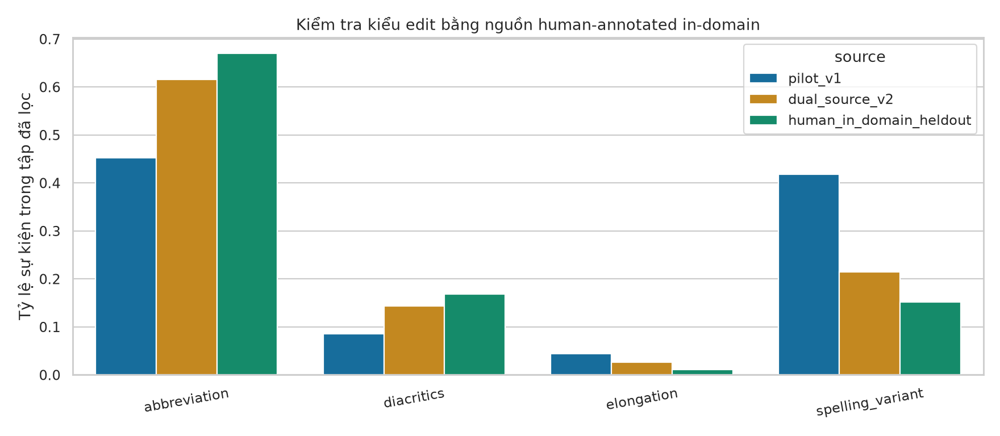

# Noise v2 — nguồn human-annotated và kiểm tra in-domain

## Vì sao có phiên bản 2

Pilot lấy biến thể từ ViLexNorm và cho thấy độ bao phủ hạn chế khi đối chiếu Small-LexNormViHSD. Quyết định v2 dựa trên dữ liệu/ngôn ngữ, không tối ưu theo test F1. Kết quả pilot được giữ riêng, không trộn điểm giữa hai testbed.

## Nguồn có sẵn

- ViLexNorm: https://aclanthology.org/2024.eacl-long.85/ ; revision `1070c6b9b00830fad278f48d9797df9ae1c942ac`. Dùng 8,372 cặp train.
- Small-LexNormViHSD: https://arxiv.org/abs/2311.06851 ; repo https://github.com/AnhHoang0529/Small-LexNormViHSD , revision `621b43c6e682df71214fec8c44836dd7a84ada52`. Dùng 1,962 cặp released train để học nguồn biến thể; giữ 219 cặp released test làm kiểm tra linguistic. Corpus này được xây từ ViHSD train, không phải toxic test độc lập.

## Chất lượng annotation gốc

[ViLexNorm, mục 3.2](https://aclanthology.org/2024.eacl-long.85.pdf) báo agreement kiểm tra chuẩn hóa theo câu 88,46% giữa tác giả và annotators, 93,54% giữa hai tác giả. Đây không phải Cohen kappa hoặc xác suất giữ nhãn toxic của generator.

[Small-LexNormViHSD, mục 3.3](https://arxiv.org/html/2311.06851) dùng hai người/câu; kappa cho quyết định token cần chuẩn hóa là 0,9014, còn agreement về cùng candidate là 0,7449. Hai chỉ số khác nhau và không thể dùng để chứng nhận nhãn toxic của câu tổng hợp.

## Thay đổi kỹ thuật

1. Mọi mapping đều có cặp gốc/chuẩn hóa và source ID. Không tự sáng tác typo hoặc tiếng lóng.
2. Trọng số chọn edit là `count(canonical, variant) / canonical_opportunities`, rồi chuẩn hóa trên các span đủ điều kiện. Sau đó nhân hệ số loại edit học từ tỷ lệ sự kiện Small-LexNorm TRAIN, tối ưu JSD có regularization và giới hạn log-weight [-3,3] trên 2000 ViHSD TRAIN comments chọn bằng hash, không dùng nhãn toxic. Đây là tỷ lệ trong corpus có chọn lọc NSW, không phải xác suất lỗi phổ quát của UGC.
3. Lọc thêm variant xuất hiện như từ không đổi trong annotation; tỷ lệ target thống nhất >=0,95 và ít nhất 2 source comments cho mapping train. Ngưỡng này là quy tắc curation, **không phải 95% xác suất giữ nhãn toxic**.
4. Variant quen thuộc trong raw ViHSD train được giữ ở bank train; chỉ đưa vào unseen khi surface vắng trong train thật. Giữ tách biệt giữa hai bank.
5. Loại 71 source pairs trùng evaluation sau bỏ whitespace/NFC/casefold; không lấy nhãn hoặc điểm test để fit.
6. Giữ ALL CAPS khi áp dụng variant và bảo toàn toàn bộ non-BMP/emoji qua preprocessing.

219 cặp linguistic test đã được xem trong quá trình phát triển, nên đây là diagnostic reference, không phải blind final test. Tham số chỉ fit trên TRAIN; không dùng test F1 của classifier.

## Kết quả kiểm tra nguồn held-out

| Chỉ số | Pilot v1 | Dual-source v2 |
|---|---:|---:|
| Mapping train | 493 | 541 |
| Mapping unseen | 430 | 422 |
| Coverage lexical events đủ điều kiện trên human in-domain held-out | 22.76% | 32.79% |
| Validation comment có sửa | 77.81% | 78.03% |
| JSD loại edit so human in-domain held-out (bits) | 0.0794 | 0.0078 |

Đây là coverage trên 369 events qua bộ lọc alignment, không phải toàn bộ NSW do con người gán nhãn. Coverage vẫn chưa đầy đủ: các từ nhiều nghĩa/cách mở rộng như một số viết tắt cảm thán và từ chỉ người bị loại để giảm rủi ro thay đổi nhãn. Không ép coverage bằng cách thêm rule tự suy đoán.

Audit bổ sung: không có exact original-text overlap giữa hai source TRAIN. Có 2 mapping mà nhiều source IDs chỉ tương ứng 1 cặp văn bản duy nhất, nên số source IDs không phải số ngữ cảnh độc lập. Bộ lọc 71 source overlaps áp dụng cho mapping evidence; prior 4 loại edit vẫn dùng toàn bộ SmallLex released TRAIN và có thể chứa các comment train trùng evaluation do split gốc. Không dùng nhãn hoặc dự đoán evaluation. Đây là giới hạn contamination còn lại, không gọi protocol là hoàn toàn không leakage.

Các loại edit được phân loại heuristic từ cặp normalization do người tạo; nguồn không cung cấp annotation thủ công cho từng loại noise này. Thứ tự: cùng dạng bỏ dấu → diacritics; dạng lặp ký tự → elongation; surface ngắn hơn → abbreviation; còn lại → spelling_variant. Vì vậy nhãn abbreviation bao gồm cả một số lỗi rút ngắn như `tiền → tìn`, không đồng nghĩa mọi edit thuộc loại này đều là viết tắt theo phân tích ngôn ngữ.

## Giới hạn kết luận

Chưa có người gán lại toxic labels cho các câu tổng hợp, nên việc giữ nhãn là giả định có lọc. Kiểm tra linguistic và JSD không chứng nhận mọi câu mới tự nhiên. Vì vậy đánh giá chính luôn gồm test ViHSD gốc có nhãn thật, nhóm UGC tự nhiên và paired corruption tests được ghi rõ là synthetic. Một sự kiện lexical/comment ở empirical profile; mức 10/20/30/50% chỉ là controlled stress và phải đọc tỷ lệ sửa thực tế.

